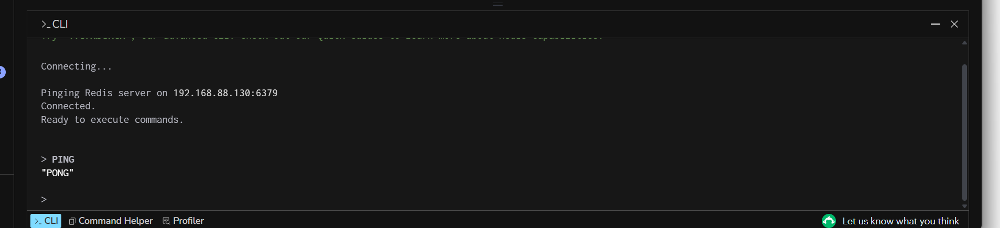

# Redis 服务器部署与远程连接实验报告

## 一、实验目的

在 VMware 的 Ubuntu 虚拟机中安装并配置 Redis 服务器，使用 Xshell 完成命令行操作，再通过 Windows 上的 Redis Insight 连接服务器，验证远程连接与密码认证是否正常。

## 二、实验环境

| 项目 | 本次实验环境 |
| --- | --- |
| 实验日期 | 2026 年 10 月 21 日 |
| 宿主机系统 | Windows |
| 虚拟化软件 | VMware Workstation Pro |
| 虚拟机系统 | Ubuntu 26.04.1 LTS |
| 远程终端 | Xshell 8 |
| Redis 服务器版本 | 8.0.5（Ubuntu 软件源安装包） |
| 虚拟机网卡 | ens33 |
| 虚拟机 IPv4 地址 | 192.168.88.130 |
| Redis 端口 | 6379 |
| 图形化客户端 | Redis Insight 3.8.0（Windows） |
| 保存的连接名称 | VMware-Redis |

> 本报告使用 `<REDIS_PASSWORD>` 代替实际 Redis 密码。复现命令时应替换为自己设置的密码，不要直接复制占位符。

## 三、实验过程

### 1. 通过 Xshell 连接虚拟机并确认环境

在 VMware 中启动 Ubuntu 虚拟机，通过 Xshell 建立 SSH 连接。以下 Linux 命令均在 Xshell 中执行。

查看操作系统信息：

```bash
cat /etc/os-release
```

系统显示为 Ubuntu 26.04.1 LTS，可使用 APT 安装 Redis。

查看 IPv4 地址：

```bash
ip -br -4 addr
```

本次网卡 `ens33` 的地址为 `192.168.88.130/24`。其中，`192.168.88.130` 用于后续 Redis Insight 连接；回环地址 `127.0.0.1` 不作为 Windows 直连虚拟机时的服务器地址。

### 2. 安装并启动 Redis

更新软件包列表并安装 Redis、配置编辑器：

```bash
sudo apt update
sudo apt install -y redis-server nano
```

启动 Redis，并设置开机自动启动：

```bash
sudo systemctl enable --now redis-server
```

首次安装后，在尚未配置密码时执行：

```bash
redis-cli ping
```

终端返回：

```text
PONG
```

说明 Redis 已安装并能够响应本机请求。

### 3. 修改 Redis 监听地址

修改前先备份配置文件：

```bash
sudo cp -a /etc/redis/redis.conf /etc/redis/redis.conf.bak
```

使用 Nano 打开配置：

```bash
sudo nano /etc/redis/redis.conf
```

找到行首没有 `#` 的实际配置行：

```conf
bind 127.0.0.1 -::1
```

将整行修改为：

```conf
bind 0.0.0.0
```

该设置使 Redis 监听所有 IPv4 网卡，从而允许 Windows 通过虚拟机 IP 连接。`0.0.0.0` 是监听配置，不是客户端连接地址。本次配置用于虚拟机实验网络，不应将 Redis 端口暴露到公网。

编辑时需要区分注释和配置：以 `#` 开头的 `bind` 示例行不会生效，应修改未注释的实际配置行。

### 4. 设置 Redis 密码

密码配置的目标形式如下，行首不带 `#`：

```conf
requirepass <REDIS_PASSWORD>
```

保护模式保持启用，无需为了远程连接将其关闭：

```conf
protected-mode yes
```

本次操作中，首次密码测试出现认证失败，随后使用命令重新设置了密码，具体处理见第四部分。

本次 Nano 界面底部显示 `^F Where Is`，搜索使用 **Ctrl+F**。编辑完成后，按 **Ctrl+O → Enter → Ctrl+X** 保存并退出。

### 5. 重启 Redis 并验证认证

保存配置后重启服务：

```bash
sudo systemctl restart redis-server
```

执行带交互式密码输入的测试命令：

```bash
redis-cli --askpass ping
```

在 `Please input password:` 后输入实际 Redis 密码。完成密码修正后，测试返回：

```text
PONG
```

此时说明本机 Redis 密码认证与命令响应正常。

### 6. 安装 Redis Insight

在 Windows 上下载 Redis Insight 官方安装程序 `Redis-Insight-win-installer.exe`，运行安装向导，选择仅为当前用户安装。

本次安装版本为 3.8.0，安装目录为：

```text
C:\Users\37575\AppData\Local\Programs\Redis Insight
```

安装完成并启动后，在首次启动页面确认隐私选项和使用条款，点击 **Submit** 进入数据库管理页面。

### 7. 添加虚拟机 Redis 连接

在 Redis Insight 中点击 **Add Redis database**，打开 **Connection settings**，填写：

| 配置项 | 本次设置 |
| --- | --- |
| Database alias | VMware-Redis |
| Host | 192.168.88.130 |
| Port | 6379 |
| Username | 留空，按课堂要求删除预填的 default |
| Password | 之前在 Redis 中设置并验证成功的密码 |
| TLS | 本次实验未配置 TLS，保持默认关闭 |

点击 **Add Redis Database** 保存连接。页面显示：

```text
Database has been added
VMware-Redis has been added to Redis Insight.
```

随后打开 `VMware-Redis`，进入数据库浏览页面。

## 四、实验中遇到的问题与解决方法

### 1. 搜索时误定位到注释示例

搜索 `bind` 时先找到的是以 `#` 开头的说明或示例，而不是实际生效的配置。

处理方法：继续向下查找，定位到未注释的 `bind 127.0.0.1 -::1`，再将整行改为 `bind 0.0.0.0`。

### 2. 误进入 Nano 帮助页面

操作过程中进入了标题为 `Main nano help text` 的帮助界面。

处理方法：按 **Ctrl+X** 关闭当前帮助页，返回配置文件继续编辑。注意以当前界面底部显示的快捷键为准。

### 3. Redis 密码认证失败

首次执行 `redis-cli --askpass ping` 时，出现：

```text
AUTH failed: WRONGPASS invalid username-password pair or user is disabled.
(error) NOAUTH Authentication required.
```

这说明认证未通过，需要核对实际生效的密码配置和输入内容。本次通过重新设置 `requirepass` 解决了问题。

首先备份当时的配置：

```bash
sudo cp -a /etc/redis/redis.conf /etc/redis/redis.conf.before-password-reset
```

删除原来启用的 `requirepass` 配置行，避免重复，再写入确定的密码：

```bash
sudo sed -i '/^[[:space:]]*requirepass[[:space:]]/d' /etc/redis/redis.conf
printf '\nrequirepass <REDIS_PASSWORD>\n' | sudo tee -a /etc/redis/redis.conf
```

然后重新启动并测试：

```bash
sudo systemctl restart redis-server
redis-cli --askpass ping
```

输入重新设置的密码后返回 `PONG`，认证恢复正常。

## 五、实验结果与成功截图

打开 Redis Insight 底部的 **CLI** 面板，连接信息显示：

```text
Pinging Redis server on 192.168.88.130:6379
Connected.
Ready to execute commands.
```

在 Redis Insight 内置 CLI 中执行：

```redis
PING
```

返回：

```text
"PONG"
```

下面是本次实验连接成功并返回 `PONG` 的实际截图：



*图 1：Redis Insight 连接 192.168.88.130:6379，并成功执行 PING。*

| 验证项目 | 实验结果 |
| --- | --- |
| Redis 安装与启动 | 成功，本机无密码初始测试返回 PONG |
| Redis 密码认证 | 修正配置后成功，带密码测试返回 PONG |
| Redis Insight 添加数据库 | 成功，显示 Database has been added |
| Windows 到虚拟机的 Redis 连接 | 成功，CLI 显示 Connected |
| 远程命令响应 | 成功，PING 返回 PONG |

## 六、实验总结

本次实验完成了在 VMware 的 Ubuntu 虚拟机中部署 Redis、通过 Xshell 修改配置，以及使用 Windows Redis Insight 远程连接的全过程。最终，Redis Insight 成功连接到 `192.168.88.130:6379`，并执行 `PING` 返回 `PONG`，证明服务器部署、网络访问和密码认证均已正常工作。

通过本次操作，掌握了 APT 软件安装、systemctl 服务管理、Redis 监听与密码配置、Nano 文件编辑，以及 Redis Insight 连接验证的方法。

## 七、参考资料

- [Redis 官方安全配置说明](https://redis.io/docs/latest/operate/oss_and_stack/management/security/)
- [Redis AUTH 命令说明](https://redis.io/docs/latest/commands/auth/)
- [Redis Insight 3.8.0 官方发布页](https://github.com/redis/RedisInsight/releases/tag/3.8.0)

> 文件使用说明：本 Markdown 文档通过相对路径引用 `assets/redis-insight-success.png`。复制或提交作业时，请将整个报告文件夹一并保留，以确保截图正常显示。
