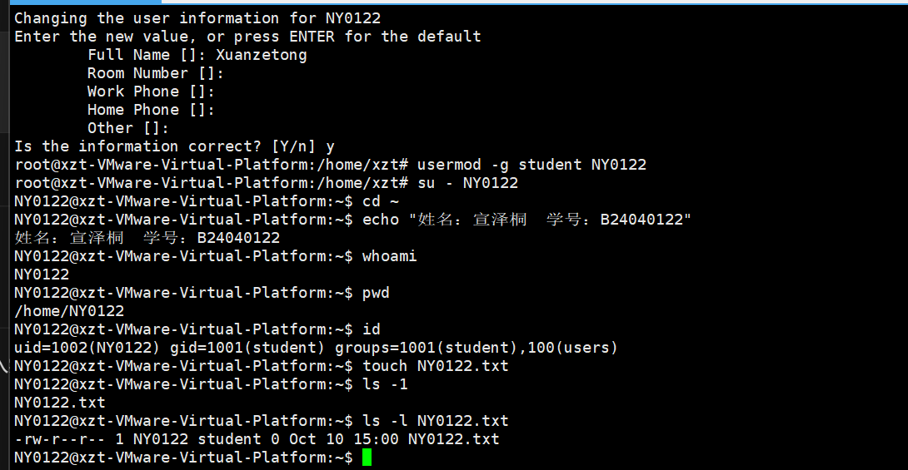
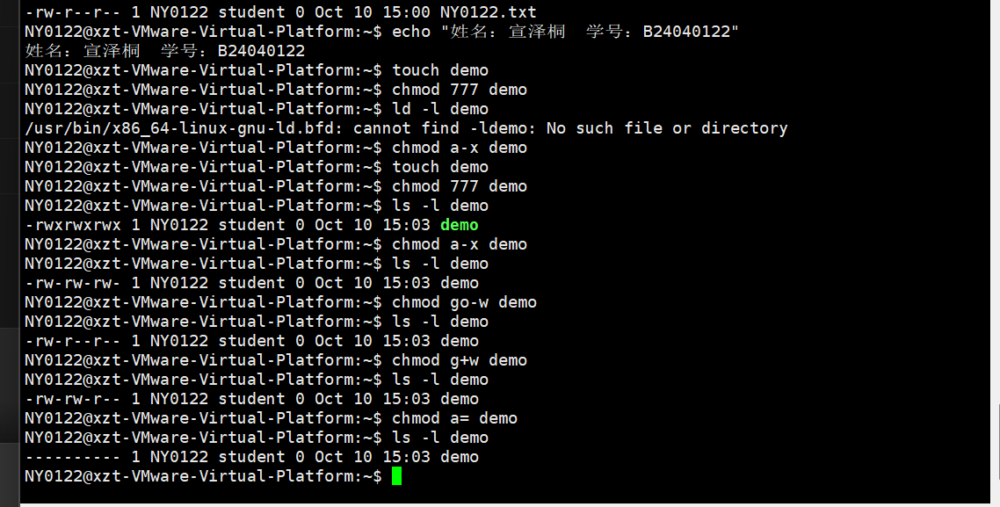
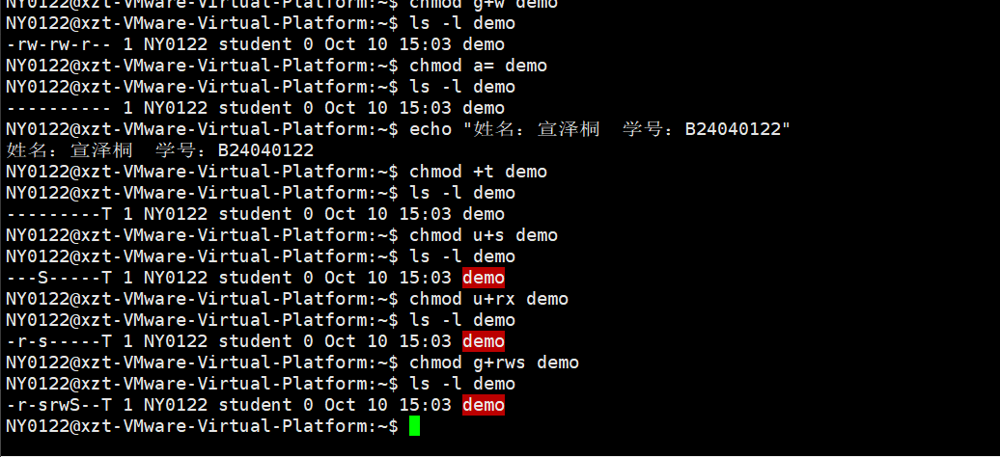
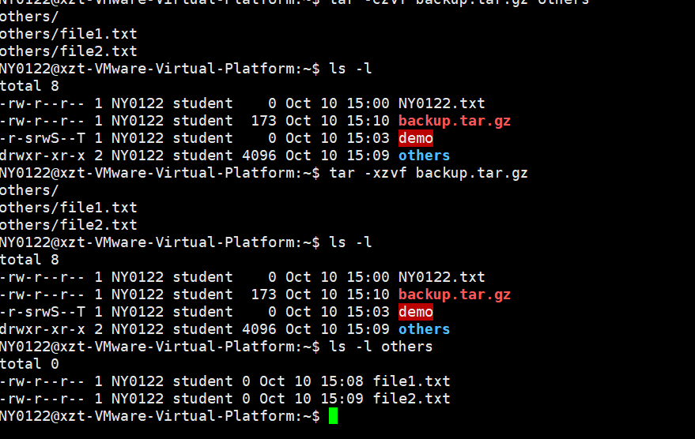
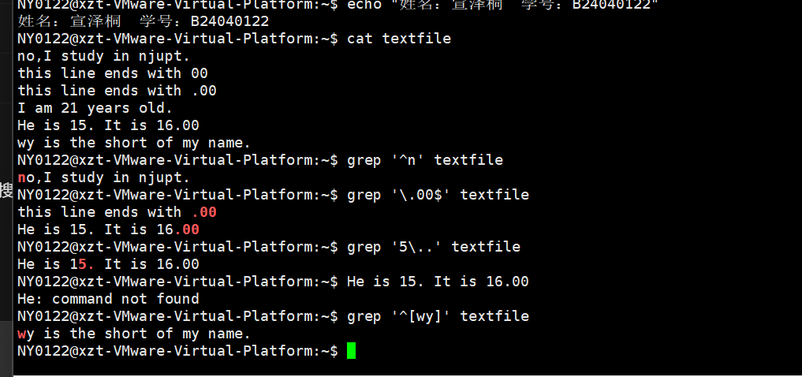

# 实验一：Linux 基本命令与管理操作

| 项目 | 内容 |
|---|---|
| 姓名 | 宣泽桐 |
| 学号 | B24040122 |
| 学号后四位 | 0122 |
| 实验日期 | 2026 年 10 月 10 日 |
| 实验环境 | VMware 虚拟机、Ubuntu 26.04.1 LTS、Xshell SSH 连接 |
| 初始登录用户 | `xzt` |
| 实验创建用户 | `NY0122` |

## 一、实验目的与要求

熟悉 Linux 操作系统的命令行环境，掌握以下基本操作：

1. 文件与目录的创建、查看、复制、重命名和删除。
2. 用户与用户组的创建、主组设置和用户切换。
3. 普通文件权限与特殊权限的设置及查看。
4. 文件归档、压缩和解压。
5. 使用 `grep` 和正则表达式搜索文本。

## 二、实验环境与记录说明

Ubuntu 运行在 VMware 虚拟机中，通过 Windows 上的 Xshell 连接并执行命令。实验文件保存在 Ubuntu 文件系统中，操作记录通过截取 Xshell 窗口保存。

前两部分在原用户 `xzt` 下执行，其主目录为 `/home/xzt`。用户管理部分通过 `sudo su root` 获取管理员权限，随后切换到 `NY0122`，在 `/home/NY0122` 下完成权限管理、压缩与文本搜索。

本文将正确操作命令整理为便于复核的形式，并如实记录操作中出现的错误及处理方法。所提供的五张截图依次用于用户管理、普通权限、特殊权限、压缩解压和文本搜索。目录与文件操作依据此前实验过程整理，未额外补造截图。

## 三、实验过程与结果

### 1. 目录操作

执行以下命令，进入主目录，创建以学号后四位命名的目录，再创建并删除内部空目录。

```bash
echo "姓名：宣泽桐  学号：B24040122"
pwd
cd ~
mkdir 0122
cd 0122
mkdir cs
ls
rmdir cs
ls
```

**结果与分析：** 初始主目录为 `/home/xzt`。进入 `0122` 后，第一次 `ls` 显示 `cs`；执行 `rmdir cs` 后，第二次 `ls` 没有显示内容，说明空目录已删除。

| 命令 | 作用 |
|---|---|
| `pwd` | 显示当前工作目录的完整路径 |
| `cd` | 切换当前工作目录 |
| `mkdir` | 创建目录 |
| `ls` | 列出目录内容 |
| `rmdir` | 删除空目录 |

操作中曾额外创建示例目录 `1234`，不影响实际实验目录 `0122` 的操作。学号后四位为 `0122`，文件与目录命名中保留开头的 `0`。

### 2. 文件操作

```bash
echo "姓名：宣泽桐  学号：B24040122"
cd ~
touch xuanzetong.txt
ls
echo "hello world" > 0122.txt
cat 0122.txt
cp xuanzetong.txt 0122_copy.txt
mv xuanzetong.txt 0122_newname.txt
ls
```

**结果与分析：** `cat 0122.txt` 输出：

```text
hello world
```

复制与重命名完成后，目录中存在 `0122.txt`、`0122_copy.txt` 和 `0122_newname.txt`。原文件名 `xuanzetong.txt` 已被重命名。

`touch` 在文件不存在时创建空文件；`>` 将输出写入文件并覆盖已有内容；`cat` 查看文件内容；`cp` 复制文件；`mv` 在本操作中实现重命名。

最初曾把目标文件名误写为 `.122.txt`，导致读取 `0122.txt` 时提示文件不存在。重新写入正确文件名后，读取成功。

### 3. 用户与用户组管理

先在原用户下执行：

```bash
whoami
sudo su root
```

按提示输入原登录用户 `xzt` 的密码，切换到管理员身份。随后执行：

```bash
groupadd student
whoami
adduser --allow-bad-names NY0122
```

实验要求用户名使用大写 `NY`，创建时使用 `--allow-bad-names` 放宽 Ubuntu 的用户名规则检查。按提示设置新用户密码，并填写姓名信息 `Xuanzetong`。

用户创建完成后执行：

```bash
usermod -g student NY0122
su - NY0122
cd ~
echo "姓名：宣泽桐  学号：B24040122"
whoami
pwd
id
touch NY0122.txt
ls -l NY0122.txt
```

**实际检查结果：**

| 检查项 | 实际结果 |
|---|---|
| 当前用户 | `NY0122` |
| 当前目录 | `/home/NY0122` |
| 用户编号 | `1002` |
| 主组 | `student`，组编号为 `1001` |
| 附加组 | `users`，组编号为 `100` |
| 文件所有者 | `NY0122` |
| 文件所属组 | `student` |

文件详细信息为：

```text
-rw-r--r-- 1 NY0122 student 0 Oct 10 15:00 NY0122.txt
```

`usermod -g` 将用户的主组设置为 `student`；`su -` 切换到该用户并加载登录环境。新建文件的所有者与所属组符合实验要求。



*图1：用户管理操作结果。截图保留了误用 `ls -1` 后改用 `ls -l` 的过程。*

### 4. 文件权限管理

在用户 `NY0122` 下创建文件 `demo`，逐步修改权限。每次修改后均使用 `ls -l demo` 查看结果。

```bash
echo "姓名：宣泽桐  学号：B24040122"
touch demo
chmod 777 demo
ls -l demo
chmod a-x demo
ls -l demo
chmod go-w demo
ls -l demo
chmod g+w demo
ls -l demo
chmod a= demo
ls -l demo
chmod +t demo
ls -l demo
chmod u+s demo
ls -l demo
chmod u+rx demo
ls -l demo
chmod g+rws demo
ls -l demo
```

**权限变化记录：**

| 操作 | 文件类型与权限字段 | 含义 |
|---|---|---|
| `chmod 777 demo` | `-rwxrwxrwx` | 三类用户均可读、写和执行 |
| `chmod a-x demo` | `-rw-rw-rw-` | 移除所有人的执行权限 |
| `chmod go-w demo` | `-rw-r--r--` | 移除所属组和其他人的写权限 |
| `chmod g+w demo` | `-rw-rw-r--` | 增加所属组的写权限 |
| `chmod a= demo` | `----------` | 清空所有普通权限 |
| `chmod +t demo` | `---------T` | 设置 sticky bit，其他人没有执行权限 |
| `chmod u+s demo` | `---S-----T` | 设置 SUID，所有者没有执行权限 |
| `chmod u+rx demo` | `-r-s-----T` | 增加所有者读、执行权限，`S` 变为 `s` |
| `chmod g+rws demo` | `-r-srwS--T` | 增加所属组读、写权限并设置 SGID，组执行权限仍为空 |

权限字段最前面的 `-` 表示普通文件，后面九位按所有者、所属组、其他人分成三组。`r`、`w`、`x` 分别表示读、写、执行，对应数值 4、2、1，因此权限值 7 表示三项权限之和。

`u`、`g`、`o`、`a` 分别表示所有者、所属组、其他人和所有人；`+`、`-`、`=` 分别用于添加、移除和直接设定权限。

`s/S` 标识 SUID 或 SGID，小写表示对应执行权限存在，大写表示不存在；`t/T` 标识 sticky bit，大小写取决于对应的其他人执行权限。此处的空文件主要用于观察权限位显示，不用于验证特殊权限的运行效果。



*图2：普通权限由 `777` 逐步调整至无普通权限。误输入 `ld` 后已重新执行正确命令。*



*图3：设置 sticky bit、SUID 和 SGID，最终权限为 `-r-srwS--T`。文件名颜色变化属于终端显示提示，并非执行错误。*

### 5. 其他管理操作

#### 5.1 文件归档、压缩与解压

整理后的操作命令如下：

```bash
cd ~
mkdir others
cd others
touch file1.txt file2.txt
ls
cd ..
tar -czvf backup.tar.gz others
ls -l
tar -xzvf backup.tar.gz
ls -l
ls -l others
```

实际创建文件时，曾在 `others` 目录内误执行 `touch others`，创建同名普通文件，随后通过以下命令将其重命名并创建第二个文件：

```bash
mv others file1.txt
touch file2.txt
```

**结果与分析：** 压缩过程列出以下路径：

```text
others/
others/file1.txt
others/file2.txt
```

生成的 `backup.tar.gz` 大小为 173 字节。解压时再次列出这三个路径，最终检查确认两个文件均存在，文件大小均为 0 字节。

| 参数 | 含义 |
|---|---|
| `c` | 创建归档 |
| `x` | 提取归档 |
| `z` | 使用 gzip 压缩或解压 |
| `v` | 显示处理过程 |
| `f` | 指定归档文件名 |

执行压缩时位于 `/home/NY0122`，即 `others` 的上一级目录。压缩后原目录仍然保留，因此在原位置解压后，文件列表可能没有明显变化，这是把归档内容恢复到已有路径的正常结果。



*图4：生成 `backup.tar.gz`，解压后检查 `others` 内的两个文件。*

#### 5.2 文本内容与正则表达式搜索

使用 `cat textfile` 检查文本内容。所附截图中实际内容为：

```text
no,I study in njupt.
this line ends with 00
this line ends with .00
I am 21 years old.
He is 15. It is 16.00
wy is the short of my name.
```

执行四条搜索命令：

```bash
grep '^n' textfile
grep '\.00$' textfile
grep '5\..' textfile
grep '^[wy]' textfile
```

| 搜索目标 | 截图中的实际匹配行 |
|---|---|
| 以 `n` 开头 | `no,I study in njupt.` |
| 以 `.00` 结尾 | `this line ends with .00`；`He is 15. It is 16.00` |
| 包含 `5`、句点、任意一个字符 | `He is 15. It is 16.00` |
| 以 `w` 或 `y` 开头 | `wy is the short of my name.` |

| 正则表达式符号 | 含义 |
|---|---|
| `^` | 行首 |
| `$` | 行尾 |
| `\.` | 字面上的句点 |
| `.` | 任意单个字符 |
| `[wy]` | 字符 `w` 或 `y` 中的一个 |

第三个模式匹配 `15.` 中的字符 `5`、其后的句点和空格。空格也是一个字符，`grep` 默认输出整条匹配行。第四个模式表示以 `w` 或 `y` 开头，而非必须连续以 `wy` 开头。



*图5：四条搜索命令均得到符合模式的结果。截图保留了文本差异及误将输出当作命令执行的记录。*

**与实验原文的差异：** 第一行逗号后少一个空格；第四行年龄为 `21`，原文为 `25`。这两处差异不改变四个搜索模式的匹配结果，但提交时应按原文修正并重新截图。当前报告保留附件原图，不将尚未提供的修正结果写成已完成事实。

如需按原文修正文本，可执行以下命令，然后重新执行四条搜索命令并更新截图：

```bash
cat > textfile <<'EOF'
no, I study in njupt.
this line ends with 00
this line ends with .00
I am 25 years old.
He is 15. It is 16.00
wy is the short of my name.
EOF
```

## 四、实验中遇到的问题及处理

| 问题 | 原因 | 处理方法 |
|---|---|---|
| `sudu` 提示命令不存在 | 把 `sudo` 拼写错误 | 改为 `sudo su root` |
| 读取 `0122.txt` 提示不存在 | 写入时误用了文件名 `.122.txt` | 统一使用 `0122.txt` 后重新写入和读取 |
| 新用户密码两次输入不一致 | 输入内容不一致 | 重新输入，最终显示密码更新成功 |
| `ls -1` 仅显示文件名 | 使用了数字 `1`，不是小写字母 `l` | 改为 `ls -l NY0122.txt` 查看详细信息 |
| `ld -l demo` 报错 | 将查看命令 `ls` 误写为链接器命令 `ld` | 重新执行 `ls -l demo` 并核对权限 |
| `cd others` 提示不是目录 | 已在外层目录内，`touch others` 创建的是普通文件 | 将该文件重命名为 `file1.txt`，再创建第二个文件 |
| `He: command not found` | 将预期输出当成命令输入 | 仅执行 `grep` 命令，输出用于对照 |
| 文本与原文不完全一致 | 逗号后空格和年龄输入有差异 | 按原文重新写入文本并补充截图 |

## 五、实验总结

通过本次实验，熟悉了在 Xshell 中远程操作 Ubuntu 的方法，能够使用基本命令完成目录创建与删除、文件写入与查看、复制与重命名、用户和主组管理、普通权限与特殊权限修改、目录归档与解压，以及正则表达式搜索。

操作中进一步理解了文件与目录的区别，以及当前用户和当前工作目录对命令结果的影响。通过逐步执行命令并检查输出，能够定位文件名错误、命令拼写错误和选项混淆等问题。

目录、文件、用户、权限和压缩操作已得到前述过程及截图验证；四条文本搜索命令的结果正确。文本内容仍需按原文修正并更新截图后，再提交最终实验记录。

---

**图片与文件说明：** 本报告通过相对路径引用 `Experiment1_images` 文件夹中的五张截图。移动或分享报告时，请将 Markdown 文件与该图片文件夹一起携带，并保持两者处于同一级目录。
